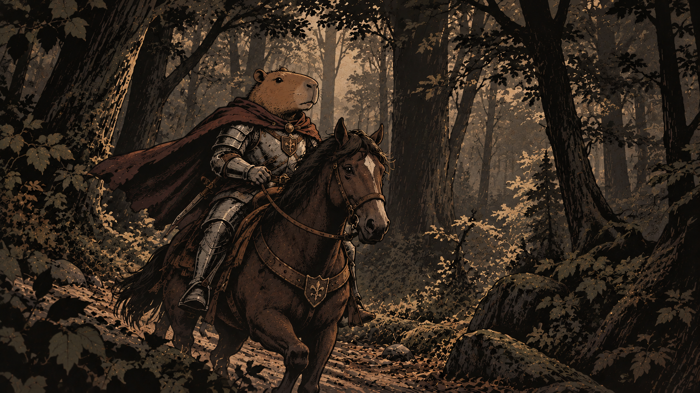
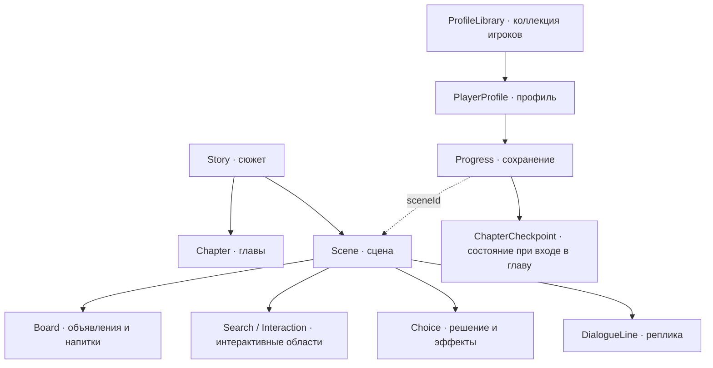

# ⚔️ Капибара-рыцарь

> Спокойный рыцарь. Неспокойная деревня. Одна ночь, о которой все говорят шёпотом.

## Играть

| В браузере на ПК, планшете и телефоне | Expo Go на iOS и Android |
| --- | --- |
| **[Открыть игру →](https://arishkawolf.github.io/Capybara-knight/)** | **[Открыть в Expo Go →](https://expo.dev/preview/update/expo-go?projectId=b8e30b51-a677-4983-be94-3a437153e320&group=6c7f321a-2162-4bf7-b2c3-9fae87454a63&slug=exp&updateRuntimeVersion=1.0.0)** |
|  |  |

Для Expo установите [Expo Go](https://expo.dev/go), совместимый с SDK 57, и отсканируйте правый QR-код. Это опубликованная версия: компьютер и локальный сервер не нужны. На iOS войдите в аккаунт внутри Expo Go.

**[Скачать Android APK →](https://github.com/ArishkaWolf/Capybara-knight/releases)** · [Инструкция для Android](MOBILE_APK.md)



К вечеру лесная дорога приводит вас к таверне «Ночная Колючка». После долгого пути хочется только согреться, поужинать и дать отдых коню. Но за соседними столами говорят об одном и том же. Посетители вздрагивают от громких голосов и оглядываются на дверь. Что-то случилось прошлой ночью — и теперь здесь боятся засыпать.

В деревне неподалёку разграблен дом. Есть слухи, напуганные жители и свидетель, который видел больше остальных. Чтобы понять, что произошло, придётся самому слушать, искать и сопоставлять. Чужой рассказ может указать путь. Маленькая деталь — заставить усомниться в нём.

**«Капибара-рыцарь»** — приключенческая визуальная новелла с детективной историей в мире лесных животных. Путешествуйте по иллюстрированным локациям, знакомьтесь с их обитателями, исследуйте предметы и принимайте решения. Найденные детали и ваши поступки отражаются в мыслях героя и его пути.

У вас есть доспехи, верный конь и завидное спокойствие капибары. Хватит ли этого, когда придётся решить, кому доверять?

Иллюстрации игры сгенерированы нейросетью.

## Об игре

| Характеристика | Описание |
| --- | --- |
| Жанр | Визуальная новелла, приключение, детектив |
| Язык | Русский |
| Платформы | Браузер · Android APK · Expo Go на Android и iOS |
| Технологии | React Native 0.86 · Expo SDK 57 · TypeScript 6 |
| Сохранения | Локальные профили с отдельным прогрессом |
| Статус | Доступна для прохождения |

## Запуск

Для запуска используй **Node.js 22 LTS версии 22.13.0 или новее в ветке 22**.

```bash
git clone https://github.com/ArishkaWolf/Capybara-knight.git
cd Capybara-knight
npm ci
npm run web
```

Для запуска на телефоне после установки зависимостей:

```bash
npm start
```

При локальной разработке откройте QR-код терминала в **Expo Go**, совместимом с Expo SDK 57. Для этого способа телефон и компьютер должны быть в одной сети; Expo CLI и Expo Go на iOS должны быть авторизованы. Для обычного прохождения используйте опубликованный QR-код выше. История рассчитана на горизонтальный экран.

Для сборки и локального просмотра браузерной версии:

```bash
npm run build:web
npm run preview
```

Готовая сборка находится в `dist/`, предпросмотр — на `http://localhost:4173`. Подробности мобильной сборки: [MOBILE_RELEASE.md](MOBILE_RELEASE.md).

Самостоятельную APK скачай из [Releases](https://github.com/ArishkaWolf/Capybara-knight/releases). Для iOS доступны браузер и Expo Go; отдельная установка через IPA пока не опубликована.

Браузерная версия публикуется через GitHub Pages автоматически после изменений в `main`. Перед публикацией проверяются типы и сюжетные переходы. На телефоне поверните экран горизонтально; в вертикальном положении игра приостанавливается.

## Сохранения

Имена игроков, текущие сцены, решения и найденные улики сохраняются автоматически. После закрытия и повторного открытия выберите свой профиль и нажмите «Продолжить историю».

В репликах и мыслях героя отображается имя выбранного игрока. Переименование профиля сразу меняет подписи, сохраняя прохождение.

В игровом меню откройте **«Пройденные главы»**, чтобы вернуться к точке входа в одну из 12 глав. Последующие решения и улики сбрасываются: можно переиграть эту часть по другому пути. История глав хранится отдельно для каждого профиля. У сохранений, созданных до этой возможности, переходы записываются с текущей сцены.

Доски в иллюстрациях интерактивны: объявления можно прочитать, а напиток выбрать нажатием на название. На маленьком экране доска открывается в увеличенном виде с прокруткой.

Сохранения локальные: у каждого устройства, браузера, Expo Go и APK отдельные данные. Они не синхронизируются между телефоном и компьютером. Очистка данных сайта, приватный режим или удаление приложения могут удалить сохранения. Обновляйте APK поверх установленной версии.

Для обновления сюжета открой игровое меню, нажми «Проверить обновления», затем «Обновить». Совместимые сцены, решения и улики сохранятся. Удалённые обновления требуют подключения к интернету.

## Проверка проекта

```bash
npm run prepare:story
npm run check
npm test
npm run build:web
npm run check:mobile
```

Проверяются типы и неиспользуемые переменные, сюжетные переходы, условия диалогов, улики, сохранения и QR-коды. Последняя команда экспортирует ресурсы для Android и iOS. APK собирается отдельно через **Actions → Build Android APK → Run workflow**, проверяется на эмуляторе и публикуется в Releases.

## Схема данных

Сюжет описан в [public/story.json](public/story.json), профили и сохранения хранятся на устройстве через AsyncStorage. Схема показывает основные структуры и связи между ними:



`Story` хранит версию, начальную сцену и список сцен. `Scene` объединяет изображение, реплики и переходы; интерактивные элементы задаются при необходимости. `Progress` хранит версию сюжета, текущую сцену, позицию в диалоге и игровое состояние. У каждого профиля своё сохранение.

Полные описания структур: [src/types.ts](src/types.ts).
